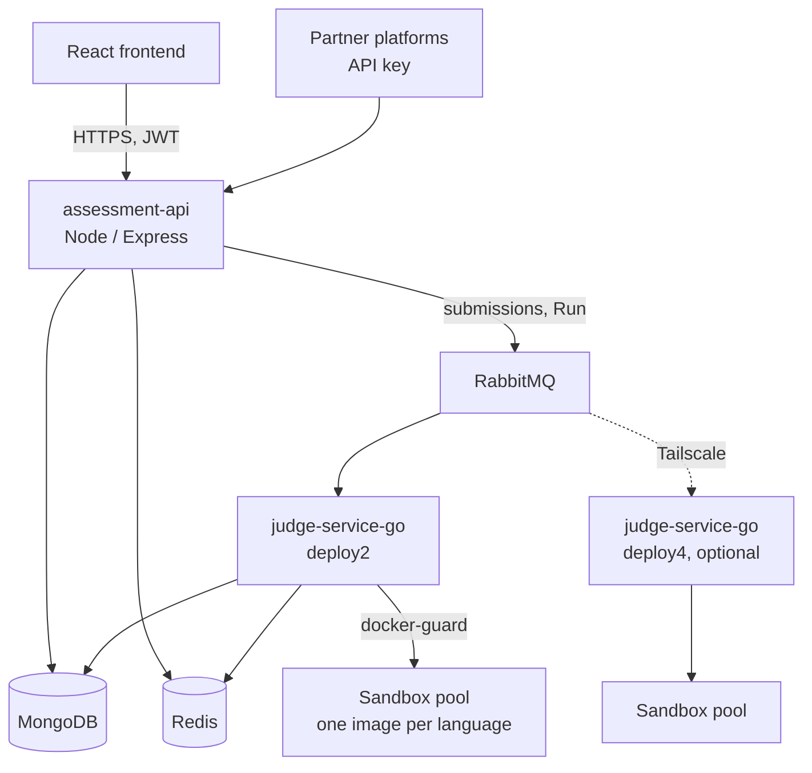

# Coding Assessment Platform and GO Judge

Two products in one repository:

1. **The assessment platform**: a multi-tenant web app for colleges. Students, faculty and admins,
   problem banks, timed and proctored assessments, placement drives and interviews.
2. **GO Judge**: the service that runs untrusted code in locked-down Docker sandboxes, in 11
   languages. It serves the platform and is also offered on its own through a public API.

Full documentation is in [`docs/`](./docs/README.md). Start there.

---

## How it fits together



- The API never runs code. It checks, attributes and queues work; a judge runs it and writes the result.
- Submissions go over `submission_queue` (bulk) and `submission_queue_fast` (callers waiting for the
  answer). Run, reference checks and raw runs go over `judge_rpc`. Whichever judge is free takes the
  next message, so more judges means more throughput ([Second Judge](./docs/judge/SECOND_JUDGE.md)).
- Each judge keeps warm sandbox containers per language: no network, read-only root, no capabilities,
  CPU and memory limits. It drives Docker only through `docker-guard`, which refuses anything but its
  own sandboxes.
- Languages: Python, JavaScript/TypeScript, Java, C, C++, C#, Go, Rust, Ruby, PHP, Kotlin. Problems are
  either `function` (LeetCode-style) or `stdin` (full programs).

Details: [Architecture](./docs/ARCHITECTURE.md).

## Repository layout

| Path | What it is |
|---|---|
| [`assessment-api/`](./assessment-api) | Node/Express API: auth, tenancy, quotas, billing, assessments, the GO Judge public API |
| [`judge-service-go/`](./judge-service-go) | The judge: queue consumers, container pool, language adapters, `cmd/docker-guard` |
| [`judge-service-go/environments/`](./judge-service-go/environments) | One Dockerfile per language sandbox image (`judge-<lang>-env`) |
| [`frontend/`](./frontend) | React + Vite UI for students, faculty and admins |
| [`contracts/`](./contracts) | JSON schemas for problems, submissions and results |
| [`scripts/`](./scripts) | Backups, cleanup, the judge contract check, test harnesses |
| [`loadtest/`](./loadtest) | `npm run loadtest`: throughput test against a live stack |
| [`e2e/`](./e2e) | Playwright browser tests |
| [`benchmark/`](./benchmark) | Older Go judge benchmark |
| [`docs/`](./docs/README.md) | All documentation |
| `docker-compose.yml` | Local development stack |
| `docker-compose.prod.yml` | Production stack (Dokploy). Deployed by **two** stacks, so a change lands on both |
| `docker-compose.judge-share.yml`, `docker-compose.judge-worker.yml` | Second judge: the share on deploy2, the worker on deploy4 |
| `docker-compose.turn.yml` | TURN relay for interview video |

## Running it locally

You need Docker with Compose v2 and Node.js 20.

```bash
git clone https://github.com/Nakul-26/leetcode-clone.git
cd leetcode-clone
docker compose up -d --build
curl localhost:3000/api/health      # wait for "status":"healthy"; the first start takes a few minutes
npm run seed:problems               # the judge certification problem set
```

| Service | Address |
|---|---|
| Frontend | http://localhost:5173 |
| API and Swagger docs | http://localhost:3000, http://localhost:3000/api-docs |
| RabbitMQ management | http://localhost:15672 (`user` / `password`, local only) |

If ports 3000 or 6379 are taken by another project, set `API_HOST_PORT=3100 REDIS_HOST_PORT=6380`
before `docker compose up`. After a session, `npm run docker:clean` removes leftover sandboxes.
More in the [Developer Guide](./docs/DEVELOPER_GUIDE.md).

## Tests

```bash
cd assessment-api && npx vitest run && npm run lint     # API, no Docker needed
cd frontend && npm test                                  # frontend
cd judge-service-go && go test . ./pkg/... -count=1      # judge unit tests
cd judge-service-go && go test -tags integration -count=1 ./...   # needs the sandbox images built
npm run test:e2e                                         # Playwright, from the repo root
```

CI (`.github/workflows/ci.yml`) runs the API, frontend and judge unit tests, the judge certification suite,
Playwright, a secret scan (gitleaks) and `npm audit --audit-level=high` (fails on any high advisory).

## Configuration and operations

Every setting, with its default, is in the [Operations Runbook](./docs/OPERATIONS_RUNBOOK.md#2-configuration-reference),
along with deploying, monitoring, capacity numbers and incident playbooks. Backups:
`scripts/backup_db.sh` and `scripts/restore_db.sh` ([Admin Guide](./docs/guides/ADMIN_GUIDE.md)).

## Features

- **Assessments**: drafts, locking once live, per-student attempts with their own timers and
  auto-submit, announcements, grace time, MCQ and subjective questions, placement drives and interviews.
- **Integrity**: tab-switch, fullscreen-exit, copy/paste and shortcut detection, recorded as
  violation events for faculty.
- **Judge**: warm container pools with autoscaling, compile once and run all tests, batched test
  execution, structured comparison (floats, trees, linked lists, unordered results), readable
  compiler diagnostics with line numbers, optional gVisor (`JUDGE_SANDBOX_RUNTIME=runsc`).
- **GO Judge public API**: per-client keys, quotas and usage metering, sync and queued calls, batches
  ([API reference](./docs/GO_JUDGE_API.md)).
